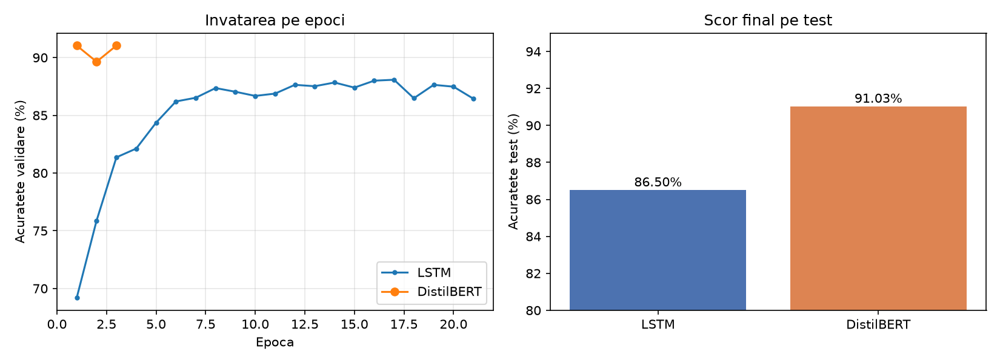

# Sentiment Analysis: LSTM from scratch vs. fine-tuned DistilBERT

Two neural networks that read a movie review and decide whether it is **positive** or **negative**,
trained on the [IMDB dataset](https://huggingface.co/datasets/stanfordnlp/imdb) (50,000 reviews)
and compared side by side:

1. **Bidirectional LSTM**, written in PyTorch and trained from scratch (the model learns English only from the reviews).
2. **DistilBERT**, a pre-trained language model, fine-tuned for this task.

## Results

| | LSTM (from scratch) | DistilBERT (fine-tuned) |
|---|---|---|
| **Test accuracy** | 86.50% | **91.03%** |
| Parameters | 2.8 M | ~67 M |
| Epochs | 21 (early stopping) | 3 |
| Training time | 443 s | 334 s |

Trained on an NVIDIA RTX 5060 Laptop GPU (8 GB), PyTorch 2.11 + CUDA 12.8.



DistilBERT wins by about 4.5 points because it already knows English from pre-training,
while the LSTM has to learn language from 22,500 reviews. Per epoch, the LSTM is much
faster, since it is ~25x smaller.

### Overfitting

The LSTM's training loss keeps dropping (0.64 → 0.04), but its validation accuracy peaks
at epoch 17 and then stalls. Early stopping (patience 4) keeps the best checkpoint.

### Known limitation: sarcasm

> *"Wow, two hours of my life I will never get back. Truly a cinematic triumph."*

Both models predict **positive with 99% confidence**, although the review is negative.
Confidence is not correctness: a model can be very sure and still wrong.

## Setup

```bash
python -m venv .venv
.venv\Scripts\Activate.ps1          # Windows PowerShell
pip install -r requirements.txt
```

For GPU support (RTX 50-series needs a CUDA 12.8 build), install PyTorch with:

```bash
pip install torch torchvision --index-url https://download.pytorch.org/whl/cu128
```

Check that PyTorch sees your GPU:

```bash
python test_gpu.py
```

## Usage

```bash
python train_lstm.py     # trains the LSTM, saves lstm_best.pt
python train_bert.py     # fine-tunes DistilBERT, saves bert_best.pt
python compare.py        # draws results.png
python predict.py        # type your own reviews and compare both models
```

The data downloads automatically on the first run. Model weights (`*.pt`) are not
included in the repository because of their size; run the training scripts to create them.

## Project structure

```
data.py          tokenizer, vocabulary, DataLoaders
model.py         the LSTM model (embedding → BiLSTM → dropout → linear)
train_lstm.py    training loop with early stopping
train_bert.py    DistilBERT fine-tuning
predict.py       interactive side-by-side demo
compare.py       plots the comparison
test_gpu.py      checks that PyTorch can use the GPU
```

## How the LSTM works

1. **Tokenize**: lowercase the text, split into words, map the 20,000 most frequent to numbers.
2. **Embedding**: each word number becomes a learned 128-dimensional vector.
3. **Bidirectional LSTM**: reads the review in both directions, keeping a memory of what it has seen.
4. **Linear layer**: turns the final memory into two scores (negative / positive).

## License

MIT